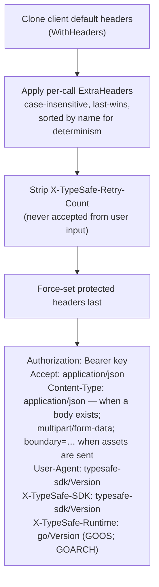
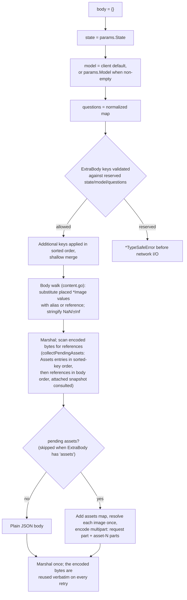

# Wire protocol

What the SDK actually sends and reads on HTTP. Owners: `transport.go`
(request prep, header merge), `json.go` (encoding), `content.go` (the body
walk: image substitution + non-finite stringification), `assets.go` /
`attached.go` / `multipart.go` (asset resolution, attachment registry,
multipart encoding), `constants.go` (paths, header names, defaults);
contract in
[contracts.md §1](../plans/2026-09-19-typesafe-sdk-go/contracts.md), locked by
the exact round-trip and header-protection matrices in `client_test.go` and
`contracts_test.go`.

## Endpoints

| | |
|---|---|
| `POST /v1/systemone` | body `{"state", "model", "questions": {name: question}}` plus any `ExtraBody` fields; sent as `multipart/form-data` when assets are pending |
| `GET /v1/models` | no body |

## A call on the wire

```mermaid
sequenceDiagram
    participant App as Your code
    participant SDK as typesafe Client
    participant API as api.typesafe.ai

    App->>SDK: SystemOne(ctx, params)
    Note over SDK: validate questions (pre-network),<br>encode body once (reused on retries)
    SDK->>API: POST /v1/systemone
    Note over SDK,API: Authorization: Bearer key<br>Accept: application/json<br>Content-Type: application/json (body present)<br>or multipart/form-data; boundary=<hex> (assets pending)<br>User-Agent: typesafe-sdk/0.7.5<br>X-TypeSafe-SDK / X-TypeSafe-Runtime
    API-->>SDK: 200 OK
    Note over API,SDK: x-typesafe-request-id: req_123
    SDK-->>App: SystemOneResponse (RequestID set, Raw buffered)
```

## Header merge order



Consequences: user headers can never override the protected set (checked
case-insensitively by the header-protection test matrix), and a first attempt
never carries `X-TypeSafe-Retry-Count` — retries set it to the retry number
(attempt 2 → `1`).

Headers the SDK **consumes** from responses: `x-typesafe-request-id` →
`resp.RequestID`; `retry-after` and `retry-after-ms` → retry delay
([Retries](retries.md)).

## Request body composition



`ExtraBody` adds top-level fields in sorted order. `state`, `model`, and
`questions` are reserved; attempting to override one fails before encoding or
network I/O. Other object values are replaced, not deep-merged. An
`ExtraBody` key `assets` is *not* reserved — it replaces the SDK's asset
machinery entirely (images neither read nor validated; the body stays plain
JSON with the user's value verbatim).

## Encoding rules

The custom marshalers in `questions.go` and `json.go` enforce the wire rules
from [Questions](questions.md#wire-form-rules):

- `"type"` first in every question object; nil optionals omitted; explicit
  `null`s nested inside values preserved; raw questions pass through
  untouched.
- Non-finite floats (`NaN`, `±Inf`) anywhere in the body — including
  `ExtraBody` — serialize as the strings `"NaN"`, `"Infinity"`,
  `"-Infinity"`; finite floats stay numbers.
- Objects are emitted with **sorted keys** (Python preserves insertion
  order), and Go's encoder escapes U+2028/U+2029 — parsed values are
  identical; see [README deviation 10](../README.md#deviations-from-the-python-sdk).
- Unencodable bodies fail before any network I/O with a
  `*TypeSafeError`. Only cycle-guard failures reuse the generic
  `The request body could not be encoded as JSON` text; every other
  walk/validation error surfaces its own message verbatim.
- **Request compression is never applied.** Python v0.7.5 compresses bodies
  ≥ 1024 bytes with zstd when available; Go's standard library has no zstd,
  so `Content-Encoding` is never set
  ([README deviation 12](../README.md#deviations-from-the-python-sdk)).

## Images and multipart

A request that carries any assets (placed `*Image` values, an `Assets` map
entry, an attached image whose reference appears, or reference text naming a
known image) is sent as `multipart/form-data`:

- Boundary: 32 random lowercase hex characters. Each part is framed per
  RFC 7578 with unescaped ASCII dispositions; the body closes with
  `--{boundary}--\r\n`.
- First part: name `request`, `Content-Type: application/json`, no
  filename — the complete JSON body, now carrying an `assets` map:
  `{"<alias-or-reference>": {"type": "image", "part": "asset-N"}}` (`type`
  before `part`, hand-encoded to survive key sorting).
- Then one part per pending asset: name and filename both `asset-N`,
  `Content-Type` sniffed from the file signature (`image/png`,
  `image/jpeg`, else `application/octet-stream`), content = raw image
  bytes. Pending order: `Assets` entries in sorted-key order — each
  uploaded even when the body never names it — then references in order of
  first appearance in the encoded body (Python uses mapping insertion
  order; sorted keys are the accepted Go deviation — part names are opaque
  to the server). The same image under N names yields N entries and N
  parts, read once.
- `Content-Type` becomes `multipart/form-data; boundary={boundary}`;
  all other headers are unchanged. The SDK never emits base64 assets —
  `data_base64` stays reachable only through `ExtraBody["assets"]`.

See [contracts.md §1b](../plans/2026-09-19-typesafe-sdk-go/contracts.md) for
the full asset contract (references, aliasing, attachments, lazy
resolution, limits).

## Response headers and redirects

The SDK's default HTTP client does not follow redirects: a 3xx response
surfaces as a plain `*APIError`, matching the other TypeSafe SDKs. Supply
your own client via `WithHTTPClient` to change that
([Configuration](configuration.md#timeout-resolution)).

Defaults (base URL, model, timeout, environment variables) are owned by
[Configuration](configuration.md) and `constants.go`.

Responses are buffered with a 16 MiB default limit (configurable through
`WithMaxResponseBodySize`). Oversized responses return
`*ResponseTooLargeError` and are not retried.
